# Loja Games — Sistema Web de Loja de Jogos

> Projeto acadêmico de loja temática desenvolvido com PHP 8, MySQL, PDO, Programação Orientada a Objetos e arquitetura MVC.

## 1. Identificação do projeto

- **Nome:** Loja Games
- **Tema:** comércio eletrônico de jogos digitais/físicos (catálogo demonstrativo)
- **Integrante:** Matheus Fernando Almeida Rodrigues (trabalho individual)
- **Disciplina / Professor:** Evandro 
- **Repositório público:** `https://github.com/Matheus-Rodrigues-9/loja-games`

## 2. Descrição do sistema

A Loja Games é um sistema web para uma loja temática de jogos. O ambiente público permite consultar o catálogo, pesquisar e filtrar jogos, visualizar detalhes, criar uma conta de cliente, autenticar-se, montar um carrinho e registrar pedidos. A área administrativa é protegida por autenticação e permite gerenciar usuários, clientes, jogos, categorias e pedidos.

O sistema utiliza uma arquitetura MVC organizada em camadas. Os Models concentram consultas e regras de negócio com PDO; os Controllers validam as requisições e coordenam o fluxo; as Views apresentam as telas HTML. O checkout valida os preços e o estoque no banco dentro de uma transação antes de registrar o pedido.

## 3. Tecnologias

- PHP 8.0 ou superior
- MySQL 8 / MariaDB (incluído no XAMPP)
- PDO e prepared statements
- Programação Orientada a Objetos (POO)
- Arquitetura MVC (Models, Views e Controllers)
- HTML5, CSS3 e JavaScript
- Git e GitHub

## 4. Funcionalidades implementadas

### Área pública

- Página inicial com catálogo de jogos e apresentação da loja.
- Pesquisa e filtro de jogos por categoria.
- Exibição de preço, descrição, imagem e disponibilidade em estoque.
- Cadastro de cliente com nome, e-mail, telefone e senha.
- Login e logout com controle de sessão.
- Senhas armazenadas com `password_hash()` e verificadas com `password_verify()`.
- Carrinho com inclusão, alteração de quantidade e remoção de itens.
- Checkout com endereço, CEP e forma de pagamento demonstrativa.
- Registro de pedido e itens, com baixa de estoque.
- Histórico e detalhes dos pedidos do cliente.

### Área administrativa

- Dashboard com indicadores de jogos, categorias, usuários, clientes e pedidos.
- CRUD de jogos, com upload de imagem e controle de estoque.
- CRUD de categorias, com proteção para impedir exclusão de categorias utilizadas.
- CRUD de usuários, com níveis administrador, operador e cliente.
- CRUD de clientes, incluindo dados de contato e endereço.
- CRUD de pedidos: registro administrativo, consulta detalhada, atualização de status, cancelamento com reposição de estoque e exclusão de pedidos cancelados.
- Proteção da área administrativa por sessão e nível de acesso.
- Proteção CSRF em operações administrativas e prepared statements.

## 5. Classes principais e CRUD

| Classe / Model | Responsabilidade | Criar | Consultar | Atualizar | Excluir |
|---|---|:---:|:---:|:---:|:---:|
| `Usuario` | Contas de acesso e permissões | ✓ | ✓ | ✓ | ✓ |
| `Cliente` | Perfil de comprador e dados de entrega | ✓ | ✓ | ✓ | ✓ |
| `Game` | Catálogo, preço, imagem e estoque | ✓ | ✓ | ✓ | ✓ |
| `Categoria` | Classificação dos jogos | ✓ | ✓ | ✓ | ✓ |
| `Pedido` | Compras, itens e andamento da venda | ✓ | ✓ | ✓ | ✓* |

`*` A exclusão física de pedido é permitida somente depois do cancelamento. O cancelamento repõe automaticamente as quantidades ao estoque. Clientes com histórico de pedidos e usuários vinculados a pedidos não podem ser excluídos, preservando a integridade referencial.

## 6. Organização de pastas

```text
loja_games/
├── admin/
│   ├── config/              # Conexão PDO e autenticação/sessão
│   ├── controllers/         # Ações administrativas legadas e logout
│   ├── models/              # Compatibilidade com telas administrativas anteriores
│   ├── views/               # Painel administrativo anterior
│   └── mvc/                 # Front controller da área MVC
├── app/
│   ├── Core/                # BaseController e recursos compartilhados
│   ├── Models/              # Usuario, Cliente, Game, Categoria e Pedido
│   ├── Controllers/         # Um controller para cada módulo principal
│   └── Views/               # Views do painel MVC e layout
├── docs/
│   ├── diagrama-classes.mmd
│   ├── modelo-banco.mmd
│   └── prints/             # Capturas de tela do sistema
├── includes/               # Cabeçalho, rodapé e funções do carrinho
├── public/
│   ├── css/style.css
│   ├── js/script.js
│   └── imagens/             # Capas e imagens enviadas
├── cadastro.php
├── carrinho.php
├── checkout.php
├── database.sql             # Script para instalação nova
├── index.php                # Página pública
├── login.php
└── README.md
```

## 7. Diagrama de classes UML

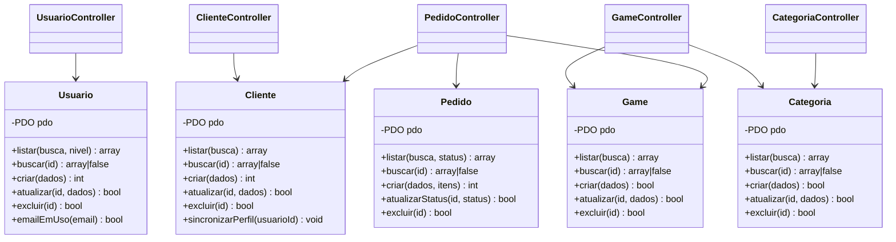

## 8. Modelo relacional do banco de dados

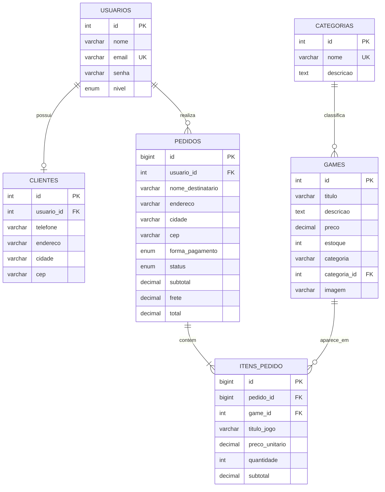

A coluna `games.categoria` é mantida para compatibilidade com telas anteriores; `games.categoria_id` é a chave estrangeira normalizada usada pelo novo CRUD MVC.

## 9. Regras de negócio

1. Somente administradores podem acessar o painel MVC e gerenciar permissões.
2. Clientes podem criar a própria conta pela página pública, mas não podem escolher o próprio nível de acesso.
3. Senhas nunca são armazenadas em texto puro.
4. O preço do pedido é recalculado a partir do banco no momento da compra; o navegador não define o preço final.
5. O estoque é bloqueado e validado dentro de uma transação ao registrar um pedido.
6. O cancelamento de pedido repõe as unidades ao estoque uma única vez.
7. Não é permitido excluir uma categoria que possua jogos vinculados.
8. Não é permitido excluir um cliente ou usuário com pedidos associados, preservando o histórico.
9. Um pedido só pode ser excluído fisicamente depois de cancelado.
10. As formas de pagamento disponíveis são demonstrativas; não existe integração com gateway de pagamento real.

## 10. Instalação e execução no XAMPP

### Requisitos

- XAMPP instalado;
- PHP 8.0 ou superior;
- MySQL ou MariaDB;
- Extensão `pdo_mysql` habilitada;
- Navegador atualizado.

### Instalação em um ambiente novo

1. Instale e abra o XAMPP.
2. Inicie os serviços **Apache** e **MySQL**.
3. Extraia a pasta `loja_games` para `C:\xampp\htdocs\crud2022\`.
4. Acesse o phpMyAdmin: `http://localhost/phpmyadmin`.
5. Na página inicial do phpMyAdmin, selecione a opção **Importar**.
6. Escolha o arquivo `database.sql`, localizado na raiz do projeto.
7. Mantenha o formato SQL e execute a importação.
8. O script criará o banco `loja_games`, suas tabelas e os registros iniciais.
9. Acesse `http://localhost/crud2022/loja_games/` para abrir a loja.

### Configuração da conexão com o banco

A conexão utiliza PDO e está localizada em:

`admin/config/conexao.php`

A configuração padrão para o XAMPP é:

| Configuração | Valor |
|---|---|
| Host | `localhost` |
| Banco de dados | `loja_games` |
| Usuário | `root` |
| Senha | Vazia |

O projeto permite configurar a conexão por meio das variáveis de ambiente `DB_HOST`, `DB_NAME`, `DB_USER` e `DB_PASS`, caso o ambiente utilize credenciais diferentes.

### Atualização de uma instalação existente

Antes de atualizar uma instalação que já contém dados:

1. Faça backup do banco de dados pelo phpMyAdmin.
2. Faça uma cópia da pasta atual do projeto.
3. Verifique se a estrutura do banco é compatível com a versão atualizada.
4. Não importe o `database.sql` sobre uma instalação existente sem avaliar previamente as alterações necessárias.

**Importante:** o arquivo `database.sql` destina-se à criação de uma instalação nova. Ele não substitui um procedimento de migração de banco de dados existente. O arquivo `setup.php` não faz parte da versão atual do projeto.

## 11. Endereços locais úteis

| Página | Endereço |
|---|---|
| Loja | `http://localhost/crud2022/loja_games/` |
| Cadastro de cliente | `http://localhost/crud2022/loja_games/cadastro.php` |
| Login | `http://localhost/crud2022/loja_games/login.php` |
| Carrinho | `http://localhost/crud2022/loja_games/carrinho.php` |
| Checkout | `http://localhost/crud2022/loja_games/checkout.php` |
| Pedidos do cliente | `http://localhost/crud2022/loja_games/meus_pedidos.php` |
| Painel MVC | `http://localhost/crud2022/loja_games/admin/mvc/` |

## 12. Acesso de demonstração

O arquivo `database.sql` inclui um registro inicial de administrador para permitir a configuração de uma instalação nova. A senha é armazenada no banco de dados em formato de hash.

Por segurança, as credenciais de acesso administrativo não são divulgadas neste repositório público. Para testar o painel administrativo, solicite as credenciais de demonstração ao responsável pelo projeto.

Para testar o perfil de cliente:

1. Acesse a página **Cadastro**.
2. Crie uma conta utilizando um e-mail de teste e um telefone fictício.
3. Faça login com a conta cadastrada.
4. Utilize as funcionalidades disponíveis para o perfil de cliente.

**Recomendação de segurança:** em qualquer ambiente de uso real, substitua as credenciais de demonstração por uma senha própria e segura.

## 13. Testes manuais antes da apresentação

- [ x ] Abrir a página inicial e confirmar que os jogos são carregados do MySQL.
- [ x ] Pesquisar jogos e filtrar por categoria.
- [ x ] Criar uma conta de cliente, sair e entrar novamente.
- [ x ] Tentar acessar o painel MVC com uma conta cliente (deve ser bloqueado).
- [ x ] Criar, editar e excluir um jogo de teste.
- [ x ] Criar, editar e excluir uma categoria sem jogos vinculados; tentar excluir uma categoria em uso (deve ser impedido).
- [ x ] Criar, editar e excluir um usuário de teste.
- [ x ] Criar e editar um cliente; tentar excluir cliente com pedido associado (deve ser impedido).
- [ x ] Criar pedido pelo checkout, confirmar baixa do estoque e conferir histórico.
- [ x ] Atualizar status do pedido, cancelar e conferir reposição do estoque.
- [ x ] Excluir um pedido somente após cancelá-lo.
- [ x ] Testar formulários vazios, e-mails inválidos e senha curta.
- [ x ] Conferir a navegação em telas menores.

## 14. Capturas de tela do sistema

As capturas abaixo registram as principais telas da Loja Games. Os dados apresentados são fictícios e foram utilizados exclusivamente para demonstração acadêmica. As 13 imagens estão armazenadas em `docs/prints/`.

### Área pública

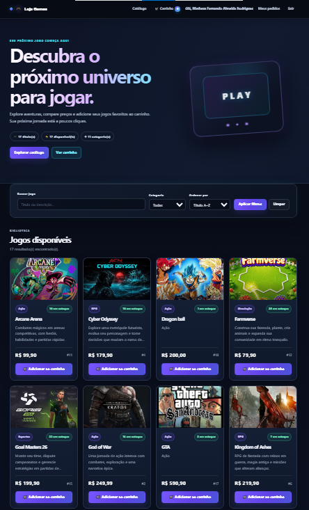

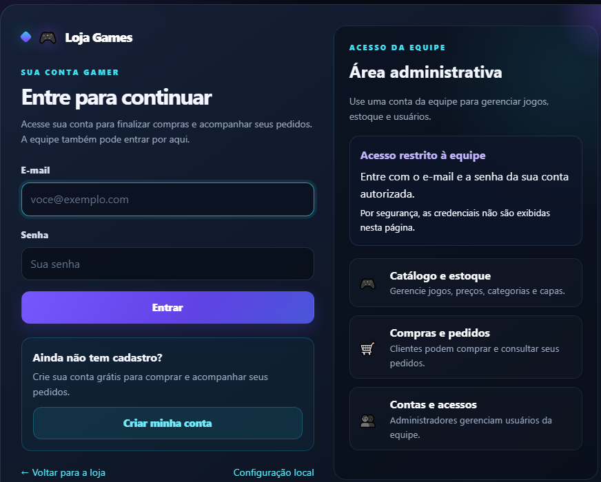

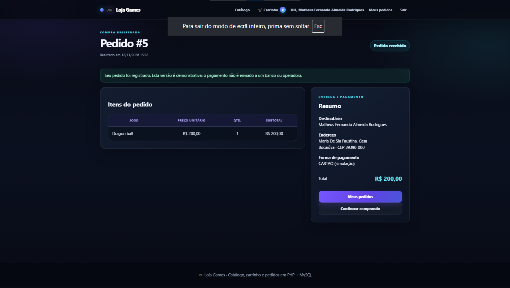

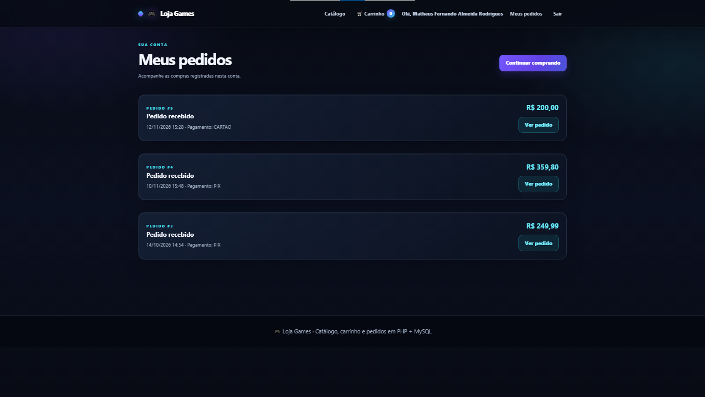

### Área administrativa

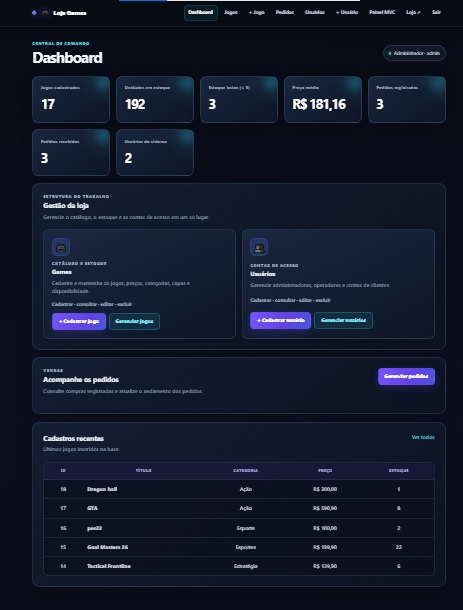

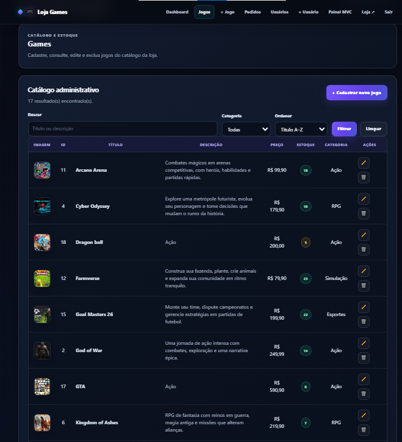

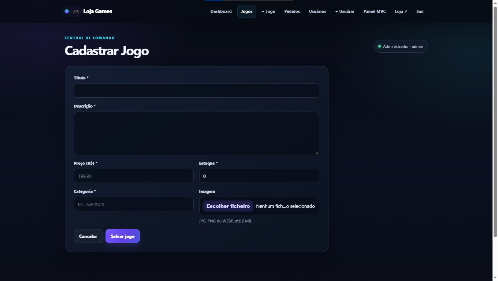

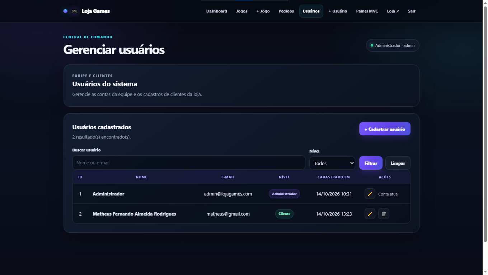

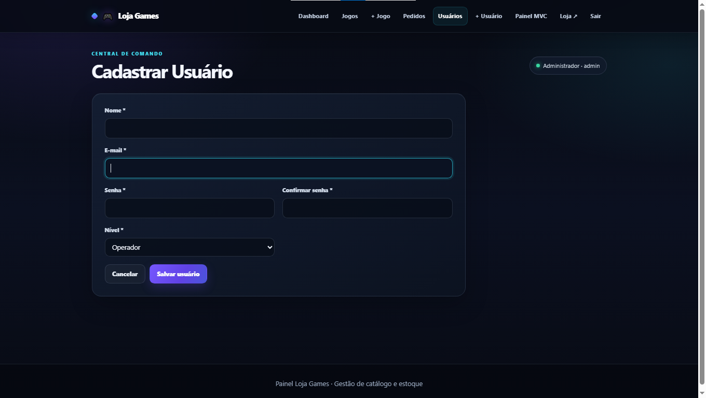


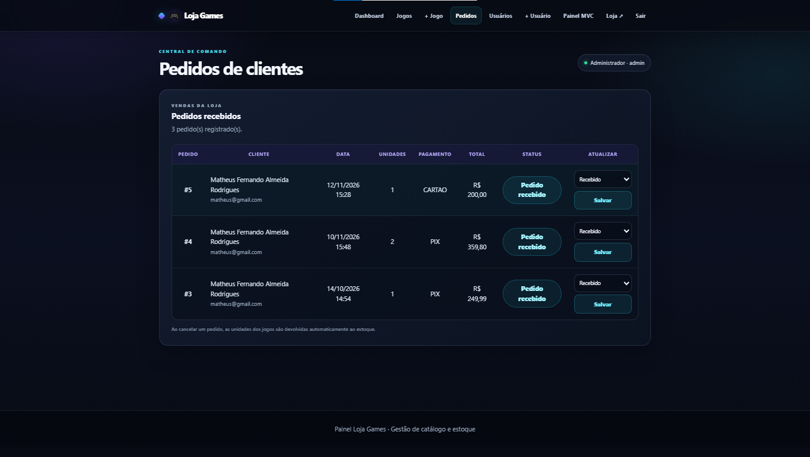

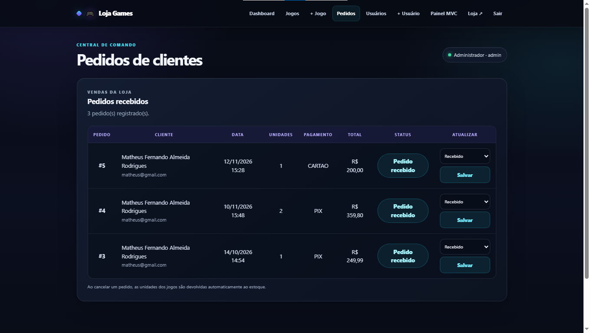

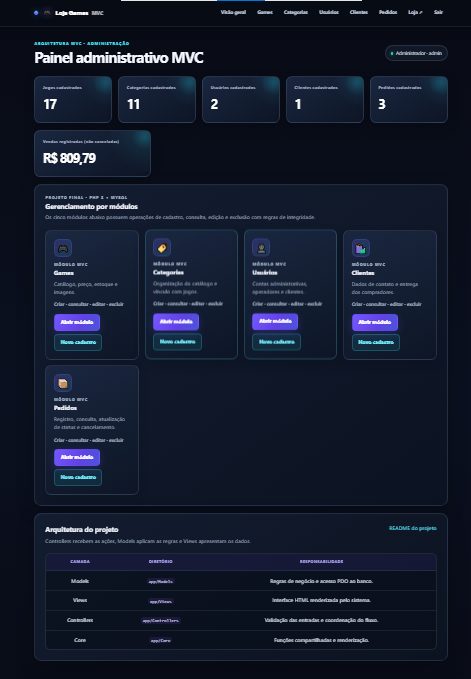


## 15. Repositório

O código-fonte da Loja Games está disponível publicamente no GitHub:

**Repositório:** https://github.com/Matheus-Rodrigues-9/loja-games

## 16. Limitações conhecidas

- O checkout registra pedidos e a forma de pagamento escolhida, mas não processa pagamentos reais.
- O sistema é uma aplicação acadêmica local. Antes de uma publicação comercial, seriam necessários HTTPS, política de privacidade, configuração segura do servidor, gestão de segredos, integração com gateway de pagamento e revisão de segurança adicional.